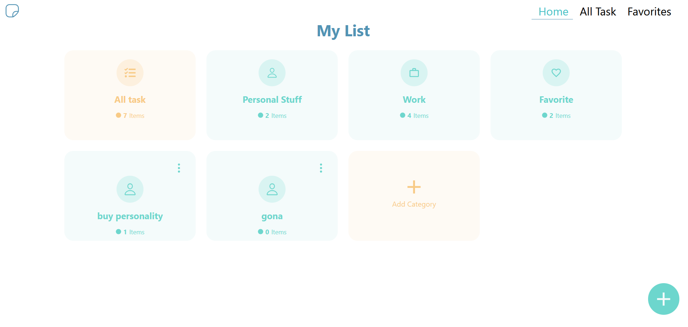
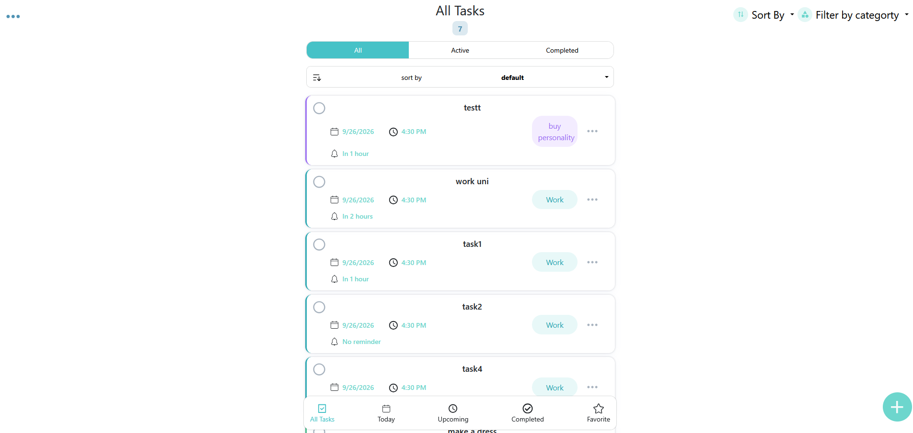
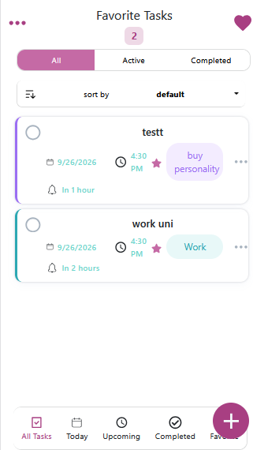
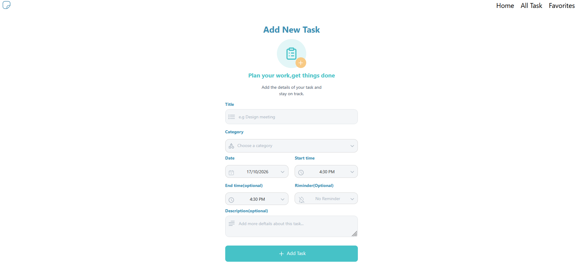

# Todo List App


This is a task manager built with React.
It lets users organize tasks into categories.

**Live Demo:** (coming soon)

## Screenshots  









## Features

- Add, edit and delete tasks
- Create, edit and delete custom categories
- Filter and sort tasks
- Mark tasks as favorite
- Data is saved in the browser using localStorage
- Responsive design for mobile and desktop

## Tech Stack

- React
- React Router
- Bootstrap
- React-Bootstrap
- React-Icons
- React-DatePicker
- SweetAlert2

## Getting Started

```bash
git clone https://github.com/nargestakalou/todolist-.git
cd todolist-/todolist
npm install
npm start
```

The app will open at `http://localhost:3000`.